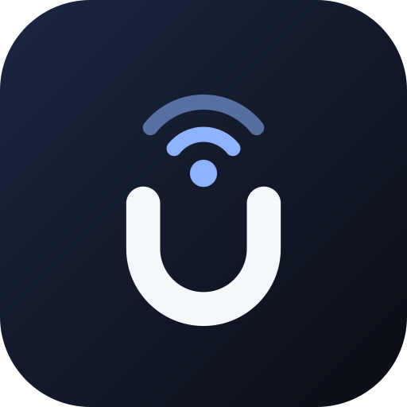

<p align="center"></p>

# Uniplay: Universal Dual Receiver (CarPlay & Android Auto)

[](https://www.gnu.org/licenses/agpl-3.0)
[-green.svg)](https://developer.android.com)
[-brightgreen.svg)](https://developer.android.com)
[](https://kotlinlang.org)
[](https://gradle.org)
[-orange.svg)]()

**Uniplay** is a wireless and USB **Android Auto** receiver for Android head units, aimed at entry-level hardware with little RAM. It shows your phone's Android Auto on the head unit's screen. Apple CarPlay is **not** supported yet.

> [!WARNING]
> **Early alpha.** It builds and passes its unit tests in CI, but it has had very little testing on real head units. Expect bugs. The released APK is signed with a debug key, so it is for testing only. Do not use it while driving.

## ⬇️ Download

Get the latest APK from the [Releases page](https://github.com/Sienz16/uniplay/releases/latest) and sideload it onto your head unit (see [Building & Installing](#️-building--installing)).

### How connecting works
- **Wireless (automatic):** pair your phone with the head unit over Bluetooth once. Uniplay starts its own hotspot where the head unit allows it (otherwise it asks for your hotspot name and password), tells the phone which Wi-Fi to join, and the phone connects. No developer mode is needed.
- **USB:** plug the phone in. Uniplay switches it into Android Open Accessory mode.
- **Manual fallback:** turn on Developer mode in the Android Auto app on the phone, start its head unit server, and tap "Connect manually".

---

## ⚡ Design Goals

1. **Low-latency video:** H.264 access units go straight to a hardware `MediaCodec` that renders onto a `SurfaceView`. Decoding and output run on their own threads, and the decoder skips ahead to the newest frame instead of replaying a backlog.
2. **Never block the link:** all sending goes through one ordered thread, audio plays from its own thread, and touch moves are coalesced so a drag never queues stale positions.
3. **Fits any screen:** the phone is told the head unit's real screen shape, so the picture is not stretched. A "Wide 16:9" mode is available if you prefer Android Auto's side-by-side layout.
4. **Memory-conscious:** small bounded buffers, and a `MemoryGuard` that watches for low-memory conditions.
5. **Plain native UI:** XML layouts, no Jetpack Compose.

---

## 📂 Project Architecture

```
uniplay/
├── app/                          # Main Android application module
│   ├── src/main/java/com/uniplay/app/
│   │   ├── ProjectionActivity.kt # True fullscreen immersive projection activity
│   │   └── DeviceRouter.kt       # USB event dispatcher & single-session manager
│   ├── src/main/res/xml/
│   │   └── device_filter.xml     # USB accessory and device VID filter rules
│   └── src/main/AndroidManifest.xml
│
├── core-common/                  # Core media & system resilience module
│   └── src/main/java/com/uniplay/core/
│       ├── ZeroCopyVideoDecoder.kt # Hardware MediaCodec H.264 decoder to Surface
│       ├── LeanAudioTrack.kt       # Low-latency AudioTrack streaming wrapper
│       ├── MemoryGuard.kt          # Active RAM monitoring and compaction utility
│       ├── MediaSink.kt            # Zero-copy callback seam for decoders
│       ├── ProjectionEngine.kt     # Common abstraction for projection protocols
│       └── ProjectionType.kt       # Projection enums and audio channel definitions
│
├── protocol-androidauto/         # Android Auto protocol implementation
│   └── src/main/java/com/uniplay/androidauto/
│       └── AndroidAutoEngine.kt   # AAP framing, AOA 2.0 transport & Protobuf dispatch
│
├── protocol-carplay/             # Apple CarPlay protocol implementation
│   └── src/main/java/com/uniplay/carplay/
│       └── CarPlayEngine.kt       # AirPlay / iAP2 framing & decrypted stream sink
│
└── gradle/                       # Build configuration & Gradle version catalogs
```

---

## 📊 Current Status

| Area | Status | Notes |
| :--- | :---: | :--- |
| **Build & unit tests (CI)** | ✅ Working | Debug unit tests and the release build run on every push. |
| **Android Auto, wireless** | 🧪 Early testing | Bluetooth handoff, Wi-Fi join and streaming work in basic testing on one setup; broader testing is needed. |
| **Android Auto, USB** | 🧪 Untested | AOA switch and bulk transport are written but have not been tried on hardware. |
| **Video decode, audio, touch** | 🧪 Early testing | Smooth in first tests; behaviour varies by head unit. |
| **GPS passthrough** | 🧪 Untested | Sends the head unit's GPS to the phone when one is available. |
| **Apple CarPlay** | ⛔ Not available | The engine is a placeholder; real CarPlay needs an authenticated AirPlay/iAP2 stack. |

---

## 🔌 Hardware Identification & Compatibility

| Standard | Vendor ID (VID) | Product ID (PID) | Connection Protocol |
| :--- | :--- | :--- | :--- |
| **Apple CarPlay** | `0x05AC` (1452) | Various (iPhone) | Not supported yet |
| **Android Auto (AOA)** | `0x18D1` (6353) | `0x2D00` / `0x2D01` | Google Android Open Accessory 2.0 |

---

## 🛠️ Building & Installing

### Prerequisites
- **JDK**: Java Development Kit 17+ (or Android Studio bundled JBR 21)
- **Android SDK**: Build-Tools `34.0.0`, Compile SDK `34`, Min SDK `21`
- **Gradle**: 8.13 (included via `./gradlew`)

### Build Commands

```bash
# 1. Clone the repository
git clone git@github.com:Sienz16/uniplay.git
cd uniplay

# 2. Build Debug APK
./gradlew assembleDebug

# 3. Build Optimized Production Release APK (with R8 minification)
./gradlew assembleRelease
```

Compiled APK locations:
* **Debug APK**: `app/build/outputs/apk/debug/app-debug.apk`
* **Release APK**: `app/build/outputs/apk/release/app-release-unsigned.apk`

### Installing to Android Head Unit via ADB

```bash
# Connect to head unit via Wi-Fi or USB debugging
adb connect <head-unit-ip>:5555

# Sideload the APK
adb install -r app/build/outputs/apk/debug/app-debug.apk
```

---

## 🤝 Third-Party Credits & Acknowledgments

Uniplay's Android Auto protocol layer is built on open-source work. See [NOTICE](NOTICE) for exactly which files come from where.

**Code included in this repository**

1. **[OpenHeadUnit](https://github.com/andreknieriem/open-headunit)** by `andreknieriem` (AGPL-3.0)
   - Android Auto protocol definitions, the TLS handshake helpers and the head-unit certificate and key used for the AAP handshake. Some files are modified.

2. **[Headunit for Android Auto](https://github.com/mikereidis/headunit)** by **Michael A. Reid** (`mikereidis`, AGPL-3.0)
   - The original open-source software Android Auto head unit that OpenHeadUnit is derived from. See [COPYRIGHT_MICHAEL_REID_GPLv3AFFERO.txt](COPYRIGHT_MICHAEL_REID_GPLv3AFFERO.txt).

**Studied for reference only (no code included)**

- **[AASDK](https://github.com/f1xpl/aasdk)** by `f1xpl`: open-source Android Auto SDK that documents AAP framing and channels.
- **[DiAuto](https://github.com/shihabal3amri/DiAuto)** and **[DiPlay](https://github.com/shihabal3amri/DiPlay)** by `shihabal3amri`: Android Auto and CarPlay receivers for BYD head units.

---

## ⚖️ License & Legal Disclaimers

### License
Uniplay is licensed under the **GNU Affero General Public License v3.0 or later (AGPL-3.0-or-later)**, because it includes AGPL-licensed code from the projects credited above. See [LICENSE](LICENSE) for the full text and [NOTICE](NOTICE) for third-party details. If you distribute a modified version, you must also make its source available under the same licence.

### Trademark Disclaimers
* **Apple CarPlay®**, **AirPlay®**, **iAP2®**, **MFi®**, and **iPhone®** are registered trademarks of **Apple Inc.**, registered in the U.S. and other countries and regions.
* **Android™**, **Android Auto™**, **Google Play™**, and **Google™** are trademarks of **Google LLC**.
* Any product names, logos, brands, and other trademarks referenced within this project are the property of their respective trademark holders. These trademark holders are not affiliated with Uniplay, our products, or our repository. They do not sponsor, endorse, or certify this open-source research.

### Automotive Safety & Driver Distraction Disclaimer
> [!CAUTION]
> **DO NOT USE OR OPERATE THIS SOFTWARE WHILE OPERATING A MOTOR VEHICLE.**
> Distracted driving can result in serious injury or death. This software is provided strictly for experimental, developmental, and laboratory research purposes. The authors and contributors assume no liability for any direct, indirect, incidental, or consequential damages resulting from the use or misuse of this software in a moving vehicle. Always keep your eyes on the road and obey all local traffic and safety laws.

---

## 🔗 Repository Information

* **Primary Repository**: [github.com/Sienz16/uniplay](https://github.com/Sienz16/uniplay)
* **SSH Remote**: `git@github.com:Sienz16/uniplay.git`
* **HTTPS Remote**: `https://github.com/Sienz16/uniplay.git`
